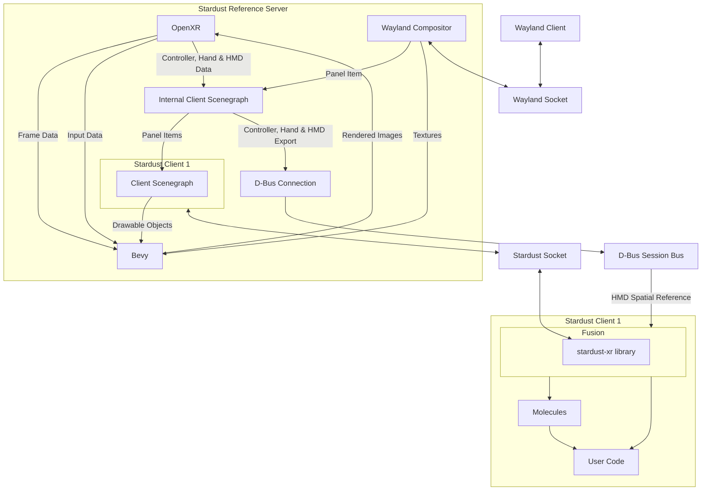

# Technical Overview

## Server

The server is what renders all the meshes of each client, takes in input from input methods, and spits out input to input handlers according to the SUIS (Spatial Universal Interaction System). As well, the server has a built-in Wayland compositor so all 2D applications can be used. It is the glue of Stardust, allowing any number of clients and apps to work in harmony while allowing the user full control in an intuitive way.

As new technologies come out, keeping the same server and trying to progressively upgrade it may lead to bloat and issues, so the protocol is designed to make creating new servers possible without too much hassle or to make servers modular. The design is highly inspired by game engines and display servers.

### Reference Server

Stardust has a reference server, but unlike other display servers this reference server is just as functional as any other Stardust server would be, because all the functionality is implemented in the clients. The server is just the glue.

The reference server uses Bevy as it is built to be highly flexible and entirely written in rust for stability and speed.

## IPC

The Stardust XR IPC uses Unix domain sockets for communication and a protocol based on flatbuffers/flexbuffers.

## Protocol

The Stardust XR protocol is object-oriented, depending on a scenegraph on the server end and scenegraph or functionally equivalent structure on the client end. This allows easier implementation of the protocol while still remaining fast and reliable.

## Clients

The clients tell the server what models to draw, where they would like to accept input in, etc. Stardust clients are much more suited to widgets or user interfaces to 2D apps.

## Architecture

